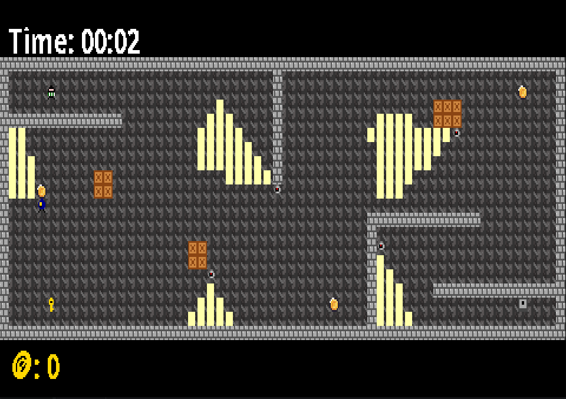

# Blind Spot: a Stealth Game in Java

A top-down stealth game. You play a thief who has to grab the key, open the safe and escape, while staying out of the light cones of patrolling police officers and rotating security cameras. Each of the three levels has tighter security and fewer places to hide.

Developed for the **Software Design and Testing Laboratory** course (L.EIC014) of the Bachelor in Informatics and Computing Engineering at FEUP (University of Porto), 2025/26, by André Baptista ([@andrefb26](https://github.com/andrefb26)), António Guedes and Diogo Santos.

<p align="center"></p>

## Gameplay

- **Stealth by line of sight:** you're caught only if you step into a lit area. Police flashlights and camera cones are computed with **ray casting**, and walls and boxes block the light, so you can hide behind them.
- **Police officers** patrol with randomised movement, and **cameras** rotate periodically.
- **Key → safe:** collect the key to unlock the safe and finish the level.
- **Coins** reduce your final time (time bonus), and the win screen shows time, bonus and final score.
- **Three levels**, loaded from text files, with a level-selection menu that tracks your progress.
- Every element, including the menu text, is drawn with sprites.

| Key | Action |
|---|---|
| Arrow keys | Move the thief (including diagonals) |
| `Enter` | Select |
| `Q` | Back to the menu |

## Design

The code follows **MVC** (model / viewer / controller packages) and applies several design patterns, all documented with UML in the [full report](docs/README.md):

| Problem | Pattern |
|---|---|
| Switching between menus, gameplay, win and lose screens | **State** |
| A consistent update cycle for every game state | **Template Method** |
| Creating the right viewer and controller for each state | **Factory Method** |
| Isolating the game from the Lanterna terminal library | **Adapter** (`GUI` interface → `LanternaGUI`) |
| Building levels from text files | **Builder** |
| Real-time execution at a fixed frame rate | **Game Loop** |

<p align="center"></p>

## Testing

About 3,500 lines of tests for about 3,000 lines of code:

- unit tests with **JUnit 5** and **Mockito** across the model, controllers, viewers and states;
- **property-based tests** with **jqwik**;
- **mutation testing** with **PIT**, so that the tests actually catch faults instead of only covering lines.

## My contribution

I worked on most areas of the game:

- the **State-based menu system** and the integration with **Lanterna** (`LanternaGUI`);
- the **sprite system** (`SpriteFactory`, and a text-to-sprite generator for menu text);
- **rotating cameras**, configured per level;
- **police movement** (random and gradual), with support for multiple officers;
- the **movement abstraction** (`Movable`, `Direction`);
- **coin collection** and the **time bonus**;
- obstacle collisions;
- unit tests, and the project report.

## Running

Requirements: JDK 17 or later (Gradle downloads the rest).

```bash
./gradlew run          # play
./gradlew test         # unit and property-based tests
./gradlew pitest       # mutation testing report
```

## Technologies

Java · Gradle · Lanterna · JUnit 5 · Mockito · jqwik · PIT
