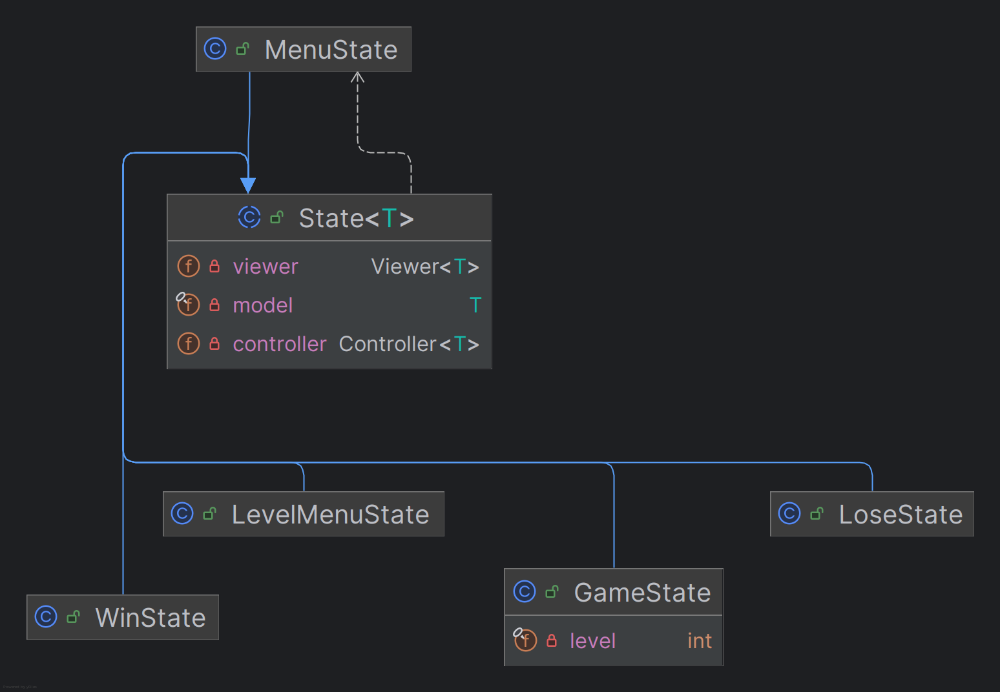
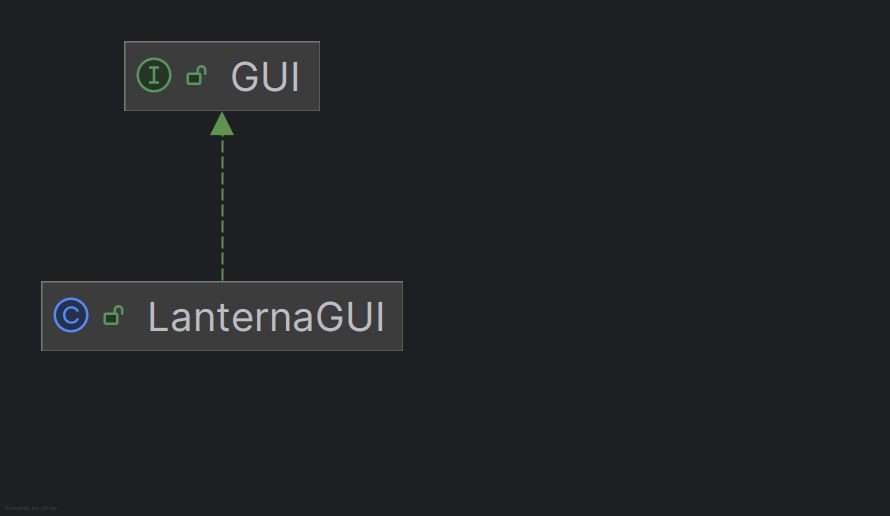
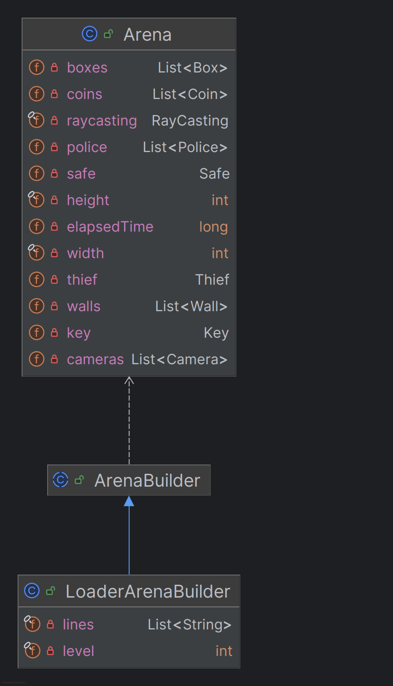
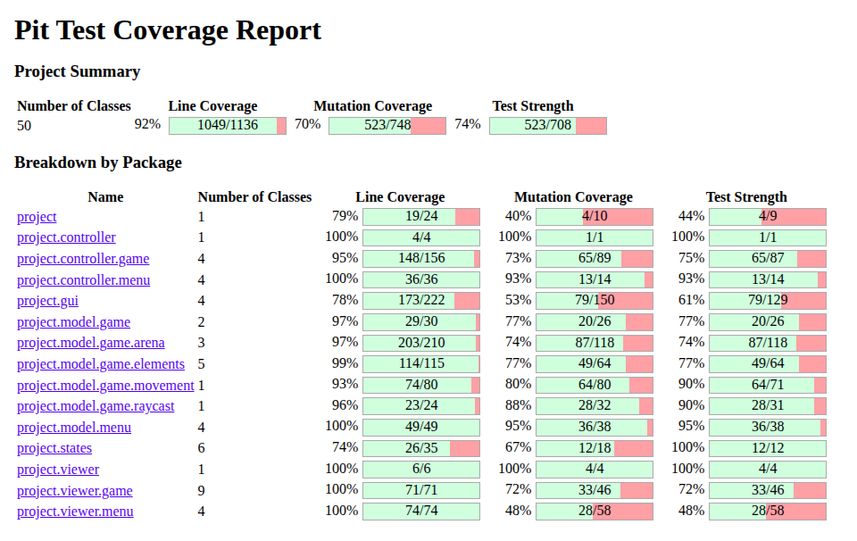

# LDTS_T02_G07 - Blindspot

## Game Description

As part of the LDTS course project, we developed an interactive stealth game with unique features called Blindspot. In this game, you are a thief ready to carry out your first heist. Your goal is to collect the key and unlock the safe while avoiding the police and staying out of the surveillance cameras' sight. The levels will increase in difficulty, presenting a growing number of security elements, less hiding spots and more complex winning strategies.

This project was developed by:
**André Ferreira Baptista**,  
**António Crispim Lopes dos Santos Anjos Guedes**,  
**Diogo Marques de Carvalho Santos**  
for **LDTS 2025/2026**.

---

## Table of Contents

- [Controls](#controls)
- [Implemented_Features](#implemented-features)
- [Planned_Features](#planned-features)
- [Design](#design)
  - [Managing Multiple Game Phases](#Managing Multiple Game Phases)
  - [Ensuring a Consistent Update Cycle](#Ensuring a Consistent Update Cycle)
  - [Decoupling Object Creation from Usage](#Decoupling Object Creation from Usage)
  - [Abstracting the Graphical Interface](#Abstracting the Graphical Interface)
  - [Constructing Complex Game Levels](#Constructing Complex Game Levels)
  - [Real-Time Game Execution](#Real-Time Game Execution)
- [Code Smells](#code-smells)
- [Testing](#testing)
- [Self-Evaluation](#self-evaluation)

---

## Controls

| Key      | Action                    |
|------------|-------------------------|
| ↑ (Up arrow) | Move thief upwards      |
| ↓ (Down arrow) | Move thief downwards    |
| ← (Left arrow) | Move thief to the left  |
| → (Right arrow) | Move thief to the right |
| Q          | Go back to the menu     |
| ENTER      | Select                  |

## Implemented Features

1-**Player-Controlled Thief**

The player controls a thief character using the arrow keys, allowing free movement across the arena. The main objective is to collect a key and use it to open the treasure safe, while also collecting coins distributed throughout the level and avoiding detection by light sources.

2-**Police Character with Dynamic Flashlight**

A police character moves randomly around the map. The police carries a flashlight that illuminates a cone-shaped area in front of it. If the thief enters this illuminated area, the player is detected and the game ends.

3-**Static Surveillance Cameras with Rotation**

The levels include static surveillance cameras positioned at strategic locations. Each camera emits a light cone and rotates periodically, changing its field of view over time. Detection by a camera also results in a game over state.

4-**Stealth and Line-of-Sight Mechanics**

Detection is based on line-of-sight and light exposure rather than direct collision. The thief is only detected when inside the illuminated areas generated by the police flashlight or the surveillance cameras, encouraging careful positioning and timing.

5-**Obstacles and Walls as Hiding Mechanics**

The arena contains boxes and walls that act as obstacles. These elements block movement, light, and line-of-sight, allowing the thief to hide behind them to avoid detection.

6-**Key Collection System**

A key is placed somewhere in the arena. The key is collected when the thief moves over its position on the map. Once collected, the key disappears from the level and enables the thief to unlock the treasure safe.

7-**Coin Collection System**

Multiple coins are distributed across the arena. When the thief moves over a coin, it is automatically collected and immediately disappears, providing clear visual feedback and encouraging exploration.

8-**Coin Counter and Time Bonus**

Each time a coin is collected, the on-screen coin counter is incremented. In addition, collected coins contribute to a time bonus, which is applied at the end of the level by reducing the final completion time, rewarding efficient exploration and risk-taking.

9-**Treasure Safe and Win Condition**

The game includes a treasure safe that remains locked until the key is collected. Successfully reaching and opening the safe triggers the level completion condition.

10-**Success Screen with Performance Feedback**

Upon completing a level, the game displays a success screen informing the player that the level was cleared. This screen shows the total completion time, a coin bonus, and the final time, and allows the player to return either to the level selection menu or to the main menu.

11-**Randomized Police Movement**

The police character follows a randomized movement pattern, making each playthrough less predictable and increasing replayability.

12-**Main Menu System**

The game includes a main menu that allows the player to start the game or exit the application. The currently selected option is visually highlighted, enabling intuitive keyboard navigation. All menu text is rendered using sprite-based text.

13-**Level Selection Menu and Progress Tracking**

A level selection screen allows the player to choose between three different levels, each with distinct layouts and challenges. The completion status of each level is displayed, supporting structured progression.

14-**Sprite-Based Visual System**

All visual elements in the game are implemented using sprites, including the thief, police, cameras, boxes, walls, coins, keys, treasure safe, floor tiles, and menu text. This ensures a consistent visual style across gameplay and menus.

## Planned Features
All planned features have been implemented.

## Design

This section describes the main design problems encountered during development and the design patterns used to solve them.
The project UML:

  

  <b><i>Project UML</i></b>

---

### Managing Multiple Game Phases

#### Problem in Context
The game contains several distinct phases, such as the main menu, level selection, gameplay, and end-game screens. Without a structured approach, the main game loop would require complex conditional logic to handle these different phases, leading to poor readability and violation of the Single Responsibility Principle.

#### The Pattern
The **State Pattern** was applied to encapsulate the behavior associated with each game phase into separate classes.

#### Implementation
An abstract `State<T>` class defines the execution flow, while concrete states such as `MenuState`, `GameState`, `WinState`, and `LoseState` implement phase-specific logic.

  

  <b><i>State</i></b>

We implemented the following structure:
* **`State<T>`** (`https://github.com/FEUP-LDTS-2025/project-t02g07/blob/012f94ae991fa35bcf5eb08ee73c4935d6b61a2a/src/main/java/project/states/State.java`): Abstract class that manages the execution.
* **`GameState`** (`https://github.com/FEUP-LDTS-2025/project-t02g07/blob/012f94ae991fa35bcf5eb08ee73c4935d6b61a2a/src/main/java/project/states/GameState.java`): Main state for the Game Loop Pattern's execution.
* **`MenuState`** (`https://github.com/FEUP-LDTS-2025/project-t02g07/blob/012f94ae991fa35bcf5eb08ee73c4935d6b61a2a/src/main/java/project/states/MenuState.java`): Stops gameplay execution and manages user selection within the Menu model.
* **`LevelMenuState`** (`https://github.com/FEUP-LDTS-2025/project-t02g07/blob/012f94ae991fa35bcf5eb08ee73c4935d6b61a2a/src/main/java/project/states/LevelMenuState.java`): Manages user interaction within the level selection menu.
* **`WinState`** (`https://github.com/FEUP-LDTS-2025/project-t02g07/blob/012f94ae991fa35bcf5eb08ee73c4935d6b61a2a/src/main/java/project/states/WinState.java`): Represents the victory screen displayed after successfully completing a level.
* **`LoseState`** (`https://github.com/FEUP-LDTS-2025/project-t02g07/blob/012f94ae991fa35bcf5eb08ee73c4935d6b61a2a/src/main/java/project/states/LoseState.java`): Represents the game over screen displayed when the player is detected.

#### Consequences
- Simplifies the game loop by removing conditional logic.
- Makes game phases explicit and isolated.
- Allows new states to be added without modifying existing code.

---

### Ensuring a Consistent Update Cycle

#### Problem in Context
All game phases require a consistent update cycle involving input processing, logic updates, and rendering. Duplicating this logic across states would lead to code duplication and inconsistencies.

#### The Pattern
The **Template Method Pattern** was applied.

#### Implementation
The `step()` method in the abstract `State<T>` class defines the fixed execution sequence, while subclasses customize specific steps by providing their own controllers and viewers.

  

  <b><i>Template Method Pattern</i></b>

We implemented the following structure:
* **`State<T>`** (`https://github.com/FEUP-LDTS-2025/project-t02g07/blob/012f94ae991fa35bcf5eb08ee73c4935d6b61a2a/src/main/java/project/states/State.java`): Abstract class that defines the template method `step()`, which establishes the fixed execution sequence of the game loop for each state.
* **`MenuState`** (`https://github.com/FEUP-LDTS-2025/project-t02g07/blob/012f94ae991fa35bcf5eb08ee73c4935d6b61a2a/src/main/java/project/states/MenuState.java`): Provides concrete implementations of the variable steps by supplying its own Controller and Viewer.
* **`LevelMenuState`** (`https://github.com/FEUP-LDTS-2025/project-t02g07/blob/012f94ae991fa35bcf5eb08ee73c4935d6b61a2a/src/main/java/project/states/LevelMenuState.java`): Customizes the execution flow by providing state-specific Controller and Viewer implementations.
* **`GameState`** (`https://github.com/FEUP-LDTS-2025/project-t02g07/blob/012f94ae991fa35bcf5eb08ee73c4935d6b61a2a/src/main/java/project/states/GameState.java`): Implements the variable steps of the template method for gameplay logic and rendering.
* **`WinState`** (`https://github.com/FEUP-LDTS-2025/project-t02g07/blob/012f94ae991fa35bcf5eb08ee73c4935d6b61a2a/src/main/java/project/states/WinState.java`): Specializes the template method steps for the victory screen.
* **`LoseState`** (`https://github.com/FEUP-LDTS-2025/project-t02g07/blob/012f94ae991fa35bcf5eb08ee73c4935d6b61a2a/src/main/java/project/states/LoseState.java`): Specializes the template method steps for the game over screen.

#### Consequences
- Enforces a uniform execution flow across states.
- Reduces code duplication.
- Improves readability and maintainability.

---

### Decoupling Object Creation from Usage

#### Problem in Context
Each game state requires different controllers and viewers. Creating these objects directly in the game loop would tightly couple object creation with execution logic.

#### The Pattern
The **Factory Method Pattern** was applied.

#### Implementation
The abstract `State<T>` class declares factory methods `getController()` and `getViewer()`, which are implemented by concrete states such as `MenuState`, `GameState`, and `WinState`.

  

  <b><i>Factory Method Pattern</i></b>

We implemented the following structure:
* **`State<T>`** (`https://github.com/FEUP-LDTS-2025/project-t02g07/blob/012f94ae991fa35bcf5eb08ee73c4935d6b61a2a/src/main/java/project/states/State.java`): Abstract class that declares the factory methods `getController()` and `getViewer()`.
* **`MenuState`** (`https://github.com/FEUP-LDTS-2025/project-t02g07/blob/012f94ae991fa35bcf5eb08ee73c4935d6b61a2a/src/main/java/project/states/MenuState.java`): Implements the factory methods to create `MenuController` and `MenuViewer`.
* **`LevelMenuState`** (`https://github.com/FEUP-LDTS-2025/project-t02g07/blob/012f94ae991fa35bcf5eb08ee73c4935d6b61a2a/src/main/java/project/states/LevelMenuState.java`):  Implements the factory methods to create `LevelMenuController` and `LevelMenuViewer`.
* **`WinState`** (`https://github.com/FEUP-LDTS-2025/project-t02g07/blob/012f94ae991fa35bcf5eb08ee73c4935d6b61a2a/src/main/java/project/states/WinState.java`):Implements the factory methods to create `WinController` and `WinViewer`.
* **`LoseState`** (`https://github.com/FEUP-LDTS-2025/project-t02g07/blob/012f94ae991fa35bcf5eb08ee73c4935d6b61a2a/src/main/java/project/states/LoseState.java`): Implements the factory methods to create `LoseController` and `LoseViewer`.
* **`GameState`** (`https://github.com/FEUP-LDTS-2025/project-t02g07/blob/012f94ae991fa35bcf5eb08ee73c4935d6b61a2a/src/main/java/project/states/GameState.java`): Implements the variable steps of the template method for gameplay logic and rendering.

#### Consequences
- Reduces coupling between game logic and object creation.
- Eliminates conditional instantiation logic.
- Improves extensibility.

---

### Abstracting the Graphical Interface

#### Problem in Context
The game uses the Lanterna library for rendering. Directly coupling the game logic to this library would reduce portability and testability.

#### The Pattern
The **Adapter Pattern** was applied.

#### Implementation
A `GUI` interface defines the graphical operations required by the game, while `LanternaGUI` adapts these operations to the Lanterna API.

  

  <b><i>Adapter Pattern</i></b>

We implemented the following classes:
* **`GUI`** (`https://github.com/FEUP-LDTS-2025/project-t02g07/blob/012f94ae991fa35bcf5eb08ee73c4935d6b61a2a/src/main/java/project/gui/GUI.java`): Interface that defines the graphical operations required by the game, independent of any concrete GUI library.
* **`LanternaGUI`** (`https://github.com/FEUP-LDTS-2025/project-t02g07/blob/012f94ae991fa35bcf5eb08ee73c4935d6b61a2a/src/main/java/project/gui/LanternaGUI.java`): Adapts the game-specific GUI operations defined in `GUI` to the Lanterna library API.

#### Consequences
- Isolates third-party dependencies.
- Improves maintainability and testability.
- Allows alternative GUI implementations.

---

### Constructing Complex Game Levels

#### Problem in Context
Game arenas are complex objects composed of walls, entities, collectibles, and lights. Creating these objects directly would result in large constructors and code that is difficult to maintain.

#### The Pattern
The **Builder Pattern** was applied.

#### Implementation
An abstract `ArenaBuilder` defines the steps for constructing an arena, while `LoaderArenaBuilder` builds arenas by loading level definition files.
We implemented the following structure:
* **`ArenaBuilder`** (`https://github.com/FEUP-LDTS-2025/project-t02g07/blob/012f94ae991fa35bcf5eb08ee73c4935d6b61a2a/src/main/java/project/model/game/arena/ArenaBuilder.java`): Abstract builder that defines the steps required to construct an `Arena`.
* **`LoaderArenaBuilder`** (`https://github.com/FEUP-LDTS-2025/project-t02g07/blob/012f94ae991fa35bcf5eb08ee73c4935d6b61a2a/src/main/java/project/model/game/arena/LoaderArenaBuilder.java`): Concrete builder that constructs the arena by loading and parsing level definition files.
* **`Arena`** (`https://github.com/FEUP-LDTS-2025/project-t02g07/blob/012f94ae991fa35bcf5eb08ee73c4935d6b61a2a/src/main/java/project/model/game/arena/Arena.java`): The complex object created by the builder, representing the game arena.

  

  <b><i>Builder Pattern</i></b>

#### Consequences
- Separates construction logic from representation.
- Simplifies level creation and extension.
- Improves code organization.

---

### Real-Time Game Execution

#### Problem in Context
The game must continuously process input, update logic, and render frames to create real-time interaction.

#### The Pattern
The **Game Loop Pattern** was applied.

#### Implementation
The main loop is implemented in the `Game.start()` method, coordinating input handling, state updates, and rendering.
We implemented this pattern in the start() method from the following class:
* **`Game`** (`https://github.com/FEUP-LDTS-2025/project-t02g07/blob/012f94ae991fa35bcf5eb08ee73c4935d6b61a2a/src/main/java/project/Game.java`)

#### Consequences
- Enables real-time gameplay.
- Ensures smooth and predictable execution.
- Centralizes the game execution flow.

---

## Final Remarks

The application of these design patterns resulted in a modular, extensible, and maintainable architecture. Each pattern addresses a specific design problem, contributing to a clean separation of responsibilities and a robust overall design.

### Code Smells:

During the development of this project, we discussed the following *Code Smells*:

#### Command Switch
*  There are central pieces of code that use a `switch` statement to handle inputs (`UP`, `DOWN`, `LEFT`,`RIGHT`, `UP_LEFT`, etc.).
*  This is a potential problem, but for now we decided to keep it because it is simple for current complexity of the game.
*  If the number of commands grows, we plane to refactor this using the Command Pattern.

#### Police Movement
* Sometimes police get "stuck" in a corner, bouncing back and forth in a very small area instead of patrolling the map as he should.
* This happens because when a police hits a wall, its direction is simply inverted.
* In a future iteration, we could change it so that when a police hits a wall, it picks a new direction that is guaranteed to be free.

#### Corner-Cutting with Diagonal Movement
* The thief can sometimes move into places that should feel blocked, by moving diagonally between two adjacent obstacles.
* It occurs because diagonal movement only checks the final target tile, if the diagonal tile is empty, the move is allowed even when both the horizontal and vertical neighbours are occupied.
* In the future, we could change this so that a diagonal move is only allowed if both adjacent orthogonal tiles are free (for example, `UP_LEFT` would require both `UP` and `LEFT` to be empty), preventing this kind of corner-cutting.

### Testing

  

  <b><i>Pitest</i></b>

### Self-Evaluation
We were three active members who helped each other regularly, sharing responsibilities and collaborating with equal contribution.
